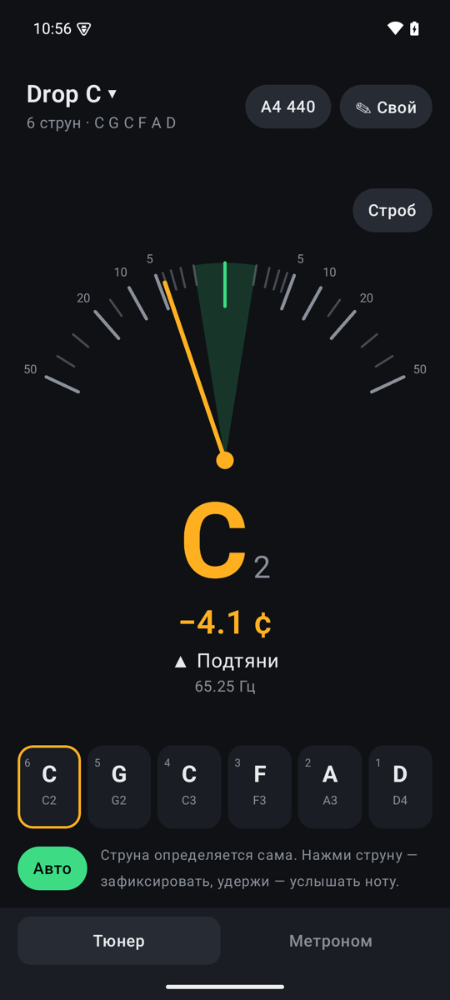
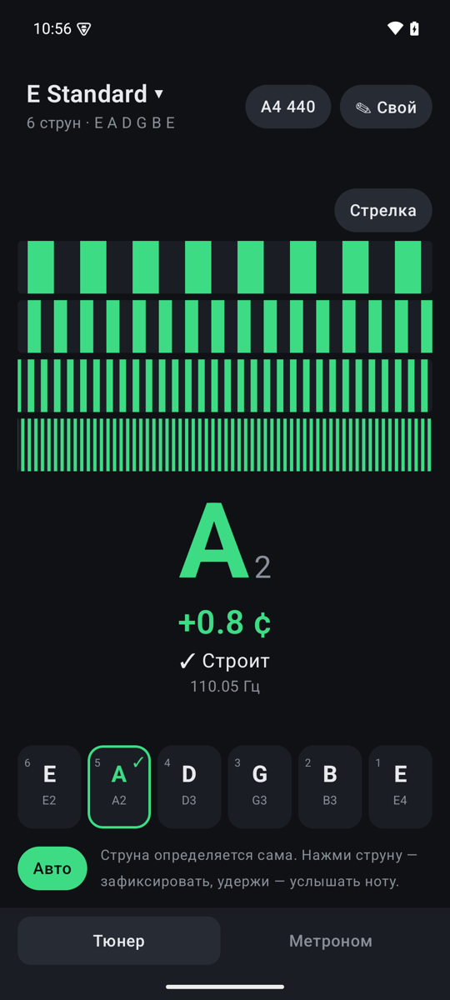
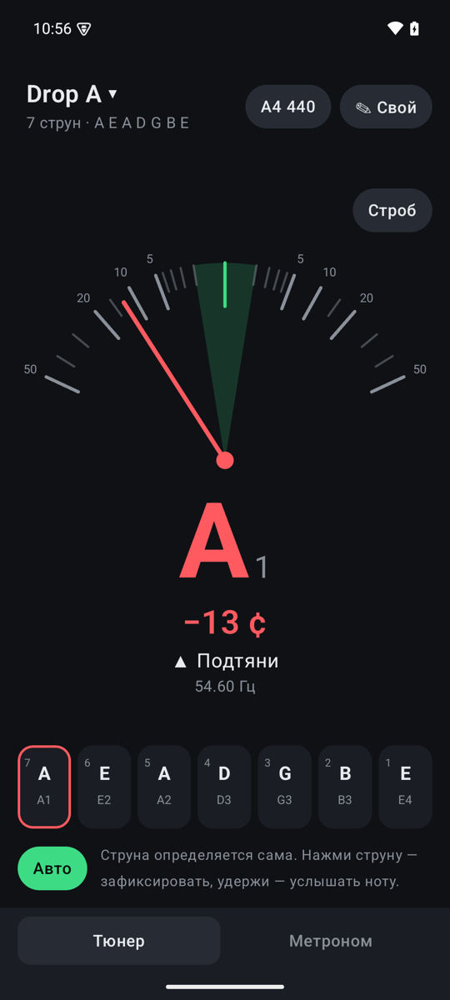
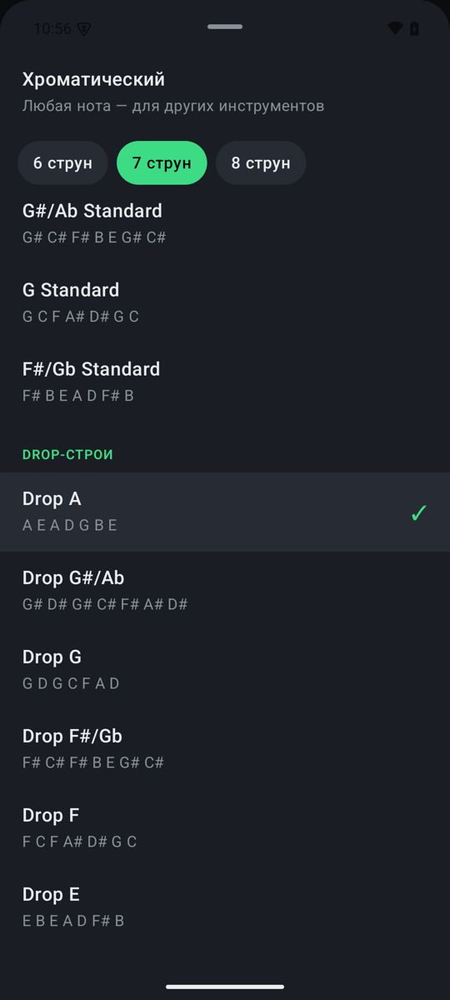
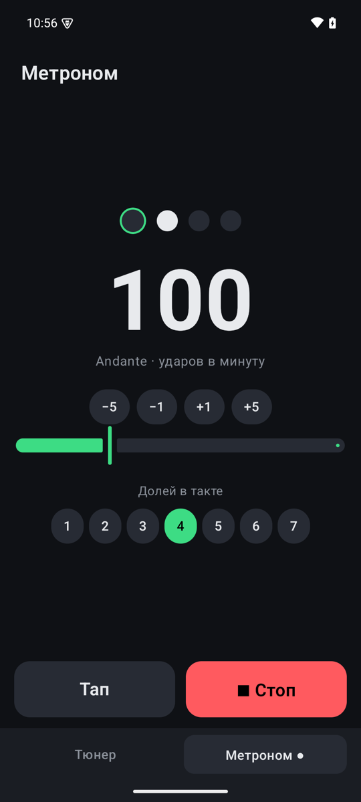

# Drop Tuner

Гитарный тюнер и метроном для Android на Kotlin + Jetpack Compose. Слушает струну через микрофон
(алгоритм YIN), сам понимает, какую струну ты дёргаешь, и показывает отклонение с точностью до десятых цента.

<p align="center">
  
  
  
  
  
</p>

<p align="center"><sub>Drop C со стрелкой · E Standard в режиме строба · 7-струнный Drop A · выбор строя · метроном</sub></p>

## Строи

| | Стандартные | Drop |
|---|---|---|
| 6 струн | E, Eb, D, C#, C, B, Bb, A Standard | Drop D, C#, C, B, A#, A, G#, G, F# |
| 7 струн | B, Bb, A, G#, G, F# Standard | Drop A, G#, G, F#, F, E |
| 8 струн | F#, F, E, D#, D Standard | Drop E, D#, D, C# |

Плюс открытые и альтернативные: Double Drop D, DADGAD, Open D / D minor / E / G / A / C.
**Хроматический** режим (в самом верху списка) — любая ближайшая нота, для других инструментов.
Кнопка **✎ Свой** — любой строй: каждая струна двигается на полутон ▲▼, сохраняется как «Свой строй».

## Как пользоваться

- Нажми на название строя сверху — откроется список (вкладки 6/7/8 струн).
- Струна определяется сама. Если перестраиваешься далеко (например, из E Standard в Drop A),
  нажми на нужную струну внизу — она зафиксируется, и измерение пойдёт только по ней.
- **Удержи струну** — телефон сыграет её ноту (точная высота, звук «щипка»). Пока нота звучит,
  тюнер не слушает, чтобы не засчитать сам себя.
- **Строб / Стрелка** — переключатель индикатора. Строб: полосы бегут вправо, если струна выше,
  влево — если ниже, и стоят на месте, когда строит; видно даже 0.1 цента. Стрелка — шкала ±50 центов,
  растянутая у нуля (корневая), чтобы ±1 цент был заметным отклонением.
- Зелёная зона — ±1 цент. Струна, удержанная в ней полсекунды, получает ✓.
- **A4** — эталон (по умолчанию 440 Гц, можно 415–466).

## Метроном

Вкладка внизу. 20–300 ударов в минуту (кнопки ±1/±5, ползунок, **Тап** — отстучать темп),
1–7 долей в такте с акцентом на первую. Клики генерируются по сэмплам, поэтому темп не плывёт
(проверено тестом на 10 минутах), а мигающая точка следует за реально звучащим кликом.
Играет, пока приложение на экране, в том числе на вкладке тюнера.

## Точность

- 48 кГц (родная частота телефонов), кадр 4096 сэмплов, новый замер каждые ~21 мс.
- YIN с разностной функцией через FFT; положение периода уточняется параболой МНК по сырой
  разностной функции, окно подгонки растёт к низким нотам.
- Медиана от выбросов + усреднение, пока нота держится: на устойчивой ноте разброс ~0.1–0.3 цента
  даже в шумной комнате; новая нота сбрасывает усреднение сразу.
- По тестам: чистый тон — < 1 цента от C#1 (34.6 Гц) до E5, синтетический щипок струны — < 1 цента,
  тон в шуме (~21 дБ) — < 3 центов на одном кадре, < 0.3 после усреднения.
- Источник микрофона — UNPROCESSED, где телефон его поддерживает: шумодав и АРУ режут
  тянущиеся ноты.

## Сборка

Нужны JDK 17 и Android SDK (platform 35). Путь к SDK — в `local.properties` (`sdk.dir=…`).
На macOS проще всего: `brew install openjdk@17` и `brew install --cask android-commandlinetools`.

```bash
./gradlew testDebugUnitTest   # тесты детектора, строёв, выбора струны, метронома
./gradlew assembleRelease     # app/build/outputs/apk/release/app-release.apk
```

**Демо-вход (только debug-сборка).** Вместо микрофона можно подать синтетическую струну нужной
частоты — так сняты скриншоты выше, и так проверяется вся цепочка на эмуляторе, где микрофона нет:

```bash
adb shell am start -n com.droptuner/.MainActivity --ef demo_hz 65.25
```

## Установка на телефон

Через USB (на телефоне включить «Отладка по USB» в параметрах разработчика):

```bash
adb install -r app/build/outputs/apk/release/app-release.apk
```

Или просто скинь APK на телефон (Telegram, кабель) и открой — Android попросит разрешить установку
из этого источника. Release-сборка подписана debug-ключом: для своего телефона этого достаточно,
для Google Play нужен отдельный ключ.

## Устройство кода

- `music/` — ноты (`Note`) и каталог строёв (`Tunings`); drop-строй генерируется из стандарта.
- `dsp/` — чистый Kotlin без Android: `Fft`, `YinPitchDetector`, `PitchTracker` (порог, медиана,
  усреднение), `ToneSynth` (опорная нота), `ClickTrack` (сэмпл-точный метроном).
- `audio/` — `FrameSource` и его реализация `MicInput` (`AudioRecord`), `AudioOut` (`AudioTrack`:
  опорная нота и клики). Синтетический `DemoSource` лежит в `src/debug` и в release не попадает.
- `tuner/` — `StringMatcher` (какая струна, с поправкой на октавную ошибку), `TunerViewModel`, настройки.
- `metronome/` — `MetronomeViewModel` и его настройки.
- `ui/` — Compose-экраны тюнера и метронома, стрелка, строб, выбор строя.
